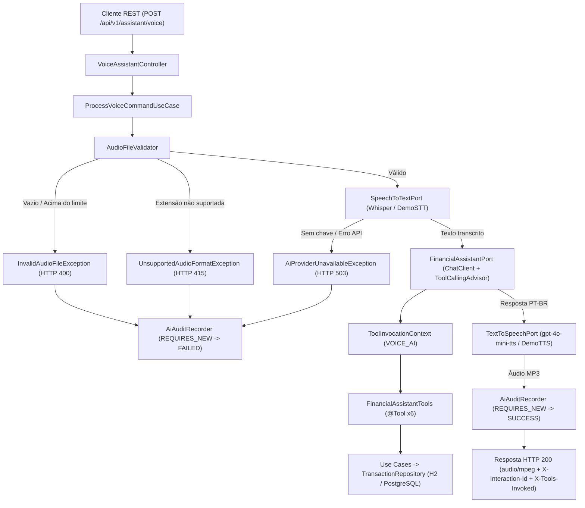
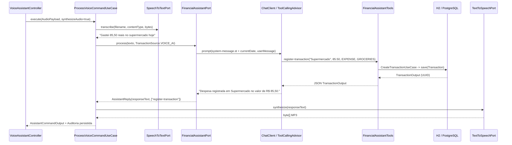

# Fala Inteligente - API de Orçamento com Spring Boot 4 & Spring AI 2

> Solução desenvolvida para o **"Desafio de Projeto: API Inteligente com Spring Boot e Spring AI"**, integrante do **"Bootcamp Java & Spring Boot promovido pelo Itaú em parceria com a Digital Innovation One (DIO)"**.

Este projeto evolui o desafio final da trilha (`05-spring-ai`) para uma arquitetura moderna de produção utilizando **Java 25**, **Spring Boot 4.1.2** (Spring Framework 7, Jakarta EE 11, Jackson 3) e **Spring AI 2.0.3**, aplicando **Clean Architecture (Hexagonal)** e **DDD** para processar comandos financeiros por voz e texto (`STT -> ChatClient/Tool Calling -> TTS`), gerar relatórios analíticos, registrar auditoria completa de IA e operar tanto com a **API da OpenAI** quanto em **modo Demo offline** sem necessidade de credenciais externas.

> Contexto oficial do desafio transcrito em [Enunciado do Desafio](enunciado.md).

---

## Sumário

1. [Arquitetura Modular (Clean Architecture + DDD)](#1-arquitetura-modular-clean-architecture--ddd)
2. [Fluxo Ponta a Ponta (Mermaid)](#2-fluxo-ponta-a-ponta)
3. [Evoluções em Relação ao Projeto Base da DIO](#3-evoluções-em-relação-ao-projeto-base-da-dio)
4. [Catálogo de Ferramentas (`@Tool`) e Engenharia de Prompt](#4-catálogo-de-ferramentas-tool-e-engenharia-de-prompt)
5. [Regras de Negócio, Validações e Auditoria](#5-regras-de-negócio-validações-e-auditoria)
6. [Endpoints da API REST](#6-endpoints-da-api-rest)
7. [Exemplos de Uso (`curl`)](#7-exemplos-de-uso-curl)
8. [Como Compilar, Testar e Executar](#8-como-compilar-testar-e-executar)
9. [O Que Foi Aprendido Durante o Desafio](#9-o-que-foi-aprendido-durante-o-desafio)

---

## 1. Arquitetura Modular (Clean Architecture + DDD)

A base de código isola completamente as regras de negócio (`domain`) e os fluxos de aplicação (`application`) dos detalhes de framework (`infrastructure`), utilizando portas e adaptadores explícitos e zero dependências de geração de código como Lombok:

```text
.
├── .env.example                                   # Variáveis de ambiente documentadas (OPENAI_API_KEY, Postgres)
├── compose.yml                                    # PostgreSQL 17 Alpine com healthcheck e volume persistente
├── Dockerfile                                     # Build multi-stage (JDK 25 -> JRE 25 Alpine não-root)
├── enunciado.md                                   # Transcrição do desafio da DIO e resumo da solução
├── mvnw / mvnw.cmd                                # Maven Wrapper oficial (Apache Maven 3.9.9)
├── pom.xml                                        # Spring Boot 4.1.2, Spring AI 2.0.3, Flyway, SpringDoc 3.2.0
└── src
    ├── main
    │   ├── java/io/github/davigdomingues/falainteligente
    │   │   ├── FalaInteligenteApplication.java
    │   │   ├── domain/                            # Núcleo 100% puro (sem Spring, JPA ou Spring AI)
    │   │   │   ├── enums/                         # Category (13), TransactionType, TransactionSource, InteractionChannel/Status
    │   │   │   ├── exception/                     # DomainValidation, ResourceNotFound, InvalidAudioFile, UnsupportedAudioFormat, AiProviderUnavailable
    │   │   │   ├── model/                         # Records imutáveis: Transaction, TransactionId, AiInteractionAudit, FinancialSummary, CategoryBreakdown, MonthlyReport, AiMetricsSummary
    │   │   │   └── port/                          # Contratos de saída: TransactionRepository, AiInteractionAuditRepository, SpeechToTextPort, TextToSpeechPort, FinancialAssistantPort
    │   │   ├── application/                       # Orquestração de casos de uso e políticas de aplicação
    │   │   │   ├── input/                         # CreateTransactionInput, TransactionFilter, AudioPayload
    │   │   │   ├── output/                        # TransactionOutput, AssistantCommandOutput, AiInteractionAuditOutput
    │   │   │   ├── service/                       # AudioFileValidator, AiAuditRecorder (REQUIRES_NEW), ToolInvocationContext
    │   │   │   └── usecase/                       # Create/List/Get/DeleteTransaction, Summary, CategoryBreakdown, MonthlyReport, ProcessVoice/TextCommand, Audit/Metrics
    │   │   └── infrastructure/                    # Adaptadores HTTP, Persistência JPA/Flyway e Spring AI 2.0
    │   │       ├── config/                        # FalaInteligenteProperties (record), ClockConfig, OpenApiConfig, AiConfiguration
    │   │       ├── ai/
    │   │       │   ├── tool/                      # FinancialAssistantTools (6 métodos @Tool)
    │   │       │   ├── adapter/                   # OpenAiConfigurationGuard, SpringAiSpeechToTextAdapter, SpringAiTextToSpeechAdapter, SpringAiFinancialAssistantAdapter
    │   │       │   └── demo/                      # DemoSpeechToTextAdapter, DemoFinancialAssistantAdapter, DemoTextToSpeechAdapter (@Profile("demo"))
    │   │       ├── persistence/
    │   │       │   ├── entity/                    # TransactionEntity, AiInteractionAuditEntity
    │   │       │   └── repository/                # SpringData*Repository (JpaSpecificationExecutor) + Adapters
    │   │       └── http/
    │   │           ├── controller/                # TransactionController, VoiceAssistantController, AuditController
    │   │           ├── dto/                       # Records de Request (Bean Validation) e Response (inclusive ApiErrorResponse)
    │   │           └── exception/                 # GlobalExceptionHandler (@RestControllerAdvice)
    │   └── resources/
    │       ├── application.yml                    # Configuração padrão: H2 + Flyway + Spring AI 2.0 + SpringDoc + Actuator
    │       ├── application-demo.yml               # Desativa modelos OpenAI para execução determinística offline
    │       ├── application-docker.yml             # DataSource PostgreSQL 17 para ambiente containerizado
    │       ├── prompts/system-message.st          # Prompt de sistema PT-BR otimizado para Tool Calling e TTS
    │       └── db/migration/                      # Scripts Flyway ANSI SQL (V1 transactions, V2 ai_interaction_audit_logs)
    └── test/
        ├── java/io/github/davigdomingues/falainteligente
        │   ├── domain/                            # Testes puros de invariantes e BigDecimal HALF_EVEN
        │   ├── application/                       # Testes unitários de validação de áudio, use cases e fluxo de falhas
        │   ├── infrastructure/ai/                 # Testes de FinancialAssistantTools e adaptadores Spring AI 2.0
        │   ├── infrastructure/http/               # Testes de integração REST (@SpringBootTest + MockMvc + H2/Flyway + perfil demo)
        │   └── OpenAiLiveIntegrationTest.java     # Teste condicional ao vivo (@EnabledIfEnvironmentVariable OPENAI_API_KEY)
        └── resources/application-test.yml
```

---

## 2. Fluxo Ponta a Ponta

### Pipeline Multimodal de Voz e Auditoria



### Sequência Interna do Tool Calling (Spring AI 2.0)



---

## 3. Evoluções em Relação ao Projeto Base da DIO

| Dimensão | Projeto Base (`05-spring-ai`) | Fala Inteligente (Esta Implementação) |
| :--- | :--- | :--- |
| **Stack & Versões** | Spring Boot `4.0.5`, Spring AI `2.0.0-M4` (milestone), Gradle, Lombok | **Spring Boot `4.1.2` GA**, **Spring AI `2.0.3` GA**, **Java 25**, Maven Wrapper, zero Lombok (Java `record`s imutáveis) |
| **Modelagem Financeira** | `amount` em `long` sem distinção entre receita e despesa; 3 categorias | **`BigDecimal` escala 2 (`HALF_EVEN`)**, **`TransactionType` (`EXPENSE` / `INCOME`)**, **13 categorias**, data contábil e `TransactionSource` (`REST`, `VOICE_AI`, `TEXT_AI`) |
| **Tool Calling** | 2 ferramentas (`persist-transaction`, `list-transactions-by-category`) | **6 ferramentas `@Tool`** cobrindo cadastro, filtragem, listagem recente, resumo financeiro, ranking percentual por categoria e exclusão |
| **Engenharia de Prompt** | `system-message.st` estático de 3 linhas | Prompt estruturado com **data dinâmica (`{currentDate}`)**, taxonomia de categorias, prevenção de alucinações e texto otimizado para TTS |
| **Persistência & Migrações** | `ddl-auto=update` com MySQL único | **Flyway migrations** versionadas (`V1`, `V2`) com `ddl-auto=validate`, **H2 zero-config** por padrão + **PostgreSQL 17** via Docker Compose |
| **Endpoints & Fluxos** | `POST /transactions`, `GET /{category}`, `POST /transactions/ai` | **14 endpoints REST** (`/api/v1/transactions/*`, `/api/v1/assistant/*`, `/api/v1/audit/*`) + `/swagger-ui.html`, `/h2-console` e `/actuator/*` |
| **Auditoria & Telemetria** | Inexistente | **`AiInteractionAudit` persistido em transação independente (`REQUIRES_NEW`)** com latência por estágio (STT, LLM, TTS), tools acionadas e taxa de sucesso |
| **Execução Sem OpenAI** | Exigia `OPENAI_API_KEY` real para qualquer teste de IA | **Guarda de configuração (`HTTP 503` explicativo)** + **perfil offline `demo`** com parser determinístico que aciona as mesmas `@Tool`s reais |
| **Testes Automatizados** | Apenas testes manuais condicionados à chave da OpenAI | **Suíte unitária + integração offline (`MockMvc` + Flyway + perfil `demo`)** + teste live condicional |

---

## 4. Catálogo de Ferramentas (`@Tool`) e Engenharia de Prompt

Todas as ferramentas vivem em [`FinancialAssistantTools`](src/main/java/io/github/davigdomingues/falainteligente/infrastructure/ai/tool/FinancialAssistantTools.java) e delegam integralmente aos casos de uso de aplicação:

| Ferramenta (`@Tool`) | Caso de Uso Acionado | Parâmetros Principais | Finalidade |
| :--- | :--- | :--- | :--- |
| `register-transaction` | `CreateTransactionUseCase` | `description`, `amount`, `type`, `category`, `transactionDate?` | Registra despesas ou receitas propagando `TransactionSource` (`VOICE_AI` ou `TEXT_AI`) |
| `list-transactions-by-category` | `ListTransactionsUseCase` | `category` | Lista transações filtradas por uma das 13 categorias financeiras |
| `list-recent-transactions` | `ListTransactionsUseCase` | `limit?` | Retorna os lançamentos mais recentes (padrão `5`, teto `50`) |
| `get-financial-summary` | `GetFinancialSummaryUseCase` | `startDate?`, `endDate?` | Consolida receitas, despesas, saldo líquido e ticket médio |
| `get-category-spending-breakdown` | `GetCategoryBreakdownUseCase` | `startDate?`, `endDate?` | Agrupa despesas por categoria com valor total e percentual |
| `delete-transaction` | `DeleteTransactionUseCase` | `transactionId` | Remove uma transação existente validando formato UUID e existência |

**Categorias disponíveis (`Category`):** `GROCERIES`, `PHARMA`, `AUTO`, `FOOD_DELIVERY`, `HOUSING`, `UTILITIES`, `LEISURE`, `HEALTH`, `EDUCATION`, `SALARY`, `FREELANCE`, `INVESTMENTS` e `OTHER`.

**Template de Sistema ([`system-message.st`](src/main/resources/prompts/system-message.st)):** instrui o modelo a utilizar `{currentDate}` para resolver datas relativas (*"hoje"*, *"ontem"*, *"este mês"*), proíbe inventar números não retornados pelas ferramentas e solicita respostas naturais sem formatação Markdown para leitura limpa pelo módulo TTS.

---

## 5. Regras de Negócio, Validações e Auditoria

1. **Invariantes Financeiras (`Transaction`):**
   - Descrição obrigatória, normalizada (`trim`), entre `2` e `200` caracteres.
   - Valor monetário estritamente positivo (`>= 0.01`) até o limite configurável (`1.000.000,00` por padrão), sempre arredondado para 2 casas decimais via `RoundingMode.HALF_EVEN`.
   - `TransactionId` encapsula `UUID` com validação explícita na entrada.
2. **Validação Defensiva de Áudio (`AudioFileValidator`):**
   - Bloqueia arquivos nulos, vazios ou acima de `15 MB` (`15.728.640 bytes`) com `InvalidAudioFileException` (`HTTP 400`).
   - Valida extensão contra `mp3, mp4, mpeg, mpga, m4a, wav, webm, ogg` com `UnsupportedAudioFormatException` (`HTTP 415`).
   - Sobrescreve `ByteArrayResource.getFilename()` em [`SpringAiSpeechToTextAdapter`](src/main/java/io/github/davigdomingues/falainteligente/infrastructure/ai/adapter/SpringAiSpeechToTextAdapter.java) garantindo que o upload multipart à OpenAI Whisper preserve o nome e extensão do arquivo.
3. **Auditoria Resiliente (`AiAuditRecorder`):**
   - Utiliza `@Transactional(propagation = Propagation.REQUIRES_NEW)` para gravar tanto sucessos (`SUCCESS`) quanto falhas (`FAILED` por arquivo inválido, formato não suportado ou ausência de chave OpenAI).
   - Registra `transcriptionLatencyMs`, `reasoningLatencyMs`, `speechLatencyMs`, `totalLatencyMs` e `toolsInvoked` (capturados via `ToolInvocationContext`).
4. **Padronização de Erros (`GlobalExceptionHandler`):**
   - `400 Bad Request`: erro de Bean Validation (`@Valid`), JSON malformado ou áudio vazio.
   - `404 Not Found`: transação ou log de auditoria não localizado.
   - `413 Content Too Large`: upload multipart acima do limite do container.
   - `415 Unsupported Media Type`: formato/extensão de áudio não suportado.
   - `422 Unprocessable Content`: violações de invariantes de domínio ou filtros de data inválidos.
   - `503 Service Unavailable`: `OPENAI_API_KEY` não configurada ou falha de comunicação com o provedor OpenAI.

---

## 6. Endpoints da API REST

### Transações & Relatórios (`/api/v1/transactions`)

| Método | Rota | Descrição | Códigos HTTP |
| :--- | :--- | :--- | :--- |
| `POST` | `/api/v1/transactions` | Cria uma nova transação financeira | `201`, `400`, `422` |
| `GET` | `/api/v1/transactions` | Lista transações (filtros opcionais `category`, `type`, `startDate`, `endDate`) | `200`, `400`, `422` |
| `GET` | `/api/v1/transactions/{id}` | Busca uma transação pelo UUID | `200`, `404`, `422` |
| `DELETE` | `/api/v1/transactions/{id}` | Exclui uma transação pelo UUID | `200`, `404`, `422` |
| `GET` | `/api/v1/transactions/summary` | Resumo financeiro consolidado (período opcional) | `200`, `422` |
| `GET` | `/api/v1/transactions/summary/by-category` | Despesas agrupadas por categoria com percentual | `200`, `422` |
| `GET` | `/api/v1/transactions/reports/monthly` | Relatório mensal completo (`year`, `month`) | `200`, `400`, `422` |

### Assistente de Voz & IA (`/api/v1/assistant`)

| Método | Rota | Descrição | Códigos HTTP |
| :--- | :--- | :--- | :--- |
| `POST` | `/api/v1/assistant/voice` | Recebe áudio (`multipart/form-data`) e devolve resposta falada (`audio/mpeg`) + headers `X-Interaction-Id`, `X-Tools-Invoked`, `X-Total-Latency-Ms` | `200`, `400`, `413`, `415`, `503` |
| `POST` | `/api/v1/assistant/voice/details` | Recebe áudio e retorna JSON completo (transcrição, resposta, tools, latências e `audioBase64` opcional) | `200`, `400`, `413`, `415`, `503` |
| `POST` | `/api/v1/assistant/text` | Interpreta comando financeiro em texto natural (com `includeAudio` opcional) | `200`, `400`, `422`, `503` |
| `POST` | `/api/v1/assistant/transcribe` | Transcreve áudio diretamente para texto (STT) | `200`, `400`, `415`, `503` |
| `POST` | `/api/v1/assistant/speech` | Converte texto em áudio MP3 (TTS) | `200`, `400`, `503` |

### Auditoria & Métricas (`/api/v1/audit`)

| Método | Rota | Descrição | Códigos HTTP |
| :--- | :--- | :--- | :--- |
| `GET` | `/api/v1/audit/interactions` | Lista registros de auditoria (filtros `status`, `channel`) | `200`, `400` |
| `GET` | `/api/v1/audit/interactions/{id}` | Detalha uma interação auditada por UUID | `200`, `404` |
| `GET` | `/api/v1/audit/metrics` | Taxa de sucesso, médias de latência e ranking de uso das tools | `200` |

---

## 7. Exemplos de Uso (`curl`)

### 1. Registrar receita e despesa via REST

```bash
curl -X POST http://localhost:8080/api/v1/transactions \
  -H "Content-Type: application/json" \
  -d '{
    "description": "Salário mensal",
    "amount": 5500.00,
    "type": "INCOME",
    "category": "SALARY",
    "transactionDate": "2026-11-05"
  }'

curl -X POST http://localhost:8080/api/v1/transactions \
  -H "Content-Type: application/json" \
  -d '{
    "description": "Compras do mês no supermercado",
    "amount": 320.45,
    "type": "EXPENSE",
    "category": "GROCERIES"
  }'
```

### 2. Enviar comando de voz (áudio -> STT -> Tool Calling -> resposta em MP3)

```bash
curl -X POST http://localhost:8080/api/v1/assistant/voice \
  -F "file=@comando.m4a" \
  -D headers.txt \
  -o resposta-assistente.mp3
```

### 3. Enviar comando de voz recebendo telemetria JSON detalhada

```bash
curl -X POST "http://localhost:8080/api/v1/assistant/voice/details?includeAudioBase64=false" \
  -F "file=@compra-mercado.m4a"
```

### 4. Enviar comando em texto natural (funciona tanto com OpenAI quanto no perfil `demo`)

```bash
curl -X POST http://localhost:8080/api/v1/assistant/text \
  -H "Content-Type: application/json" \
  -d '{
    "message": "Paguei 64,90 reais na farmácia hoje",
    "includeAudio": false
  }'
```

### 5. Consultar relatórios financeiros, auditoria e métricas de IA

```bash
# Resumo financeiro e breakdown por categoria
curl http://localhost:8080/api/v1/transactions/summary
curl http://localhost:8080/api/v1/transactions/summary/by-category
curl "http://localhost:8080/api/v1/transactions/reports/monthly?year=2026&month=11"

# Auditoria e métricas do pipeline de IA
curl http://localhost:8080/api/v1/audit/interactions
curl http://localhost:8080/api/v1/audit/metrics
```

---

## 8. Como Compilar, Testar e Executar

> Pré-requisito: JDK 25 ou superior instalado (compilado e validado com JDK 26). Não é necessário instalar o Maven globalmente pois o repositório inclui o Maven Wrapper oficial (`mvnw` / `mvnw.cmd`).

### Executar a Suíte Completa de Testes e Empacotamento

#### Linux / macOS

```bash
./mvnw clean verify
```

#### Windows (PowerShell)

```powershell
.\mvnw.cmd clean verify
```

> Todos os testes unitários e de integração (`H2`, `Flyway`, `MockMvc` e perfil `demo`) executam 100% offline. O teste ao vivo [`OpenAiLiveIntegrationTest`](src/test/java/io/github/davigdomingues/falainteligente/OpenAiLiveIntegrationTest.java) é executado automaticamente quando `OPENAI_API_KEY` está definida no ambiente.

### Modos de Execução da Aplicação

#### Modo 1 - Perfil Offline `demo` (sem chave da OpenAI)

Ideal para demonstrações locais imediatas, validação do fluxo de voz/texto, testes no Swagger UI e inspeção no H2 Console sem depender de API externa:

```bash
# Linux / macOS
./mvnw spring-boot:run -Dspring-boot.run.profiles=demo

# Windows (PowerShell)
.\mvnw.cmd spring-boot:run -Dspring-boot.run.profiles=demo
```

#### Modo 2 - OpenAI Real (Whisper + GPT-4o-mini + TTS)

```bash
# Linux / macOS
export OPENAI_API_KEY="sk-sua-chave-aqui"
./mvnw spring-boot:run

# Windows (PowerShell)
$env:OPENAI_API_KEY="sk-sua-chave-aqui"
.\mvnw.cmd spring-boot:run
```

#### Modo 3 - PostgreSQL 17 via Docker Compose

```bash
# 1. Subir o banco PostgreSQL 17 em container
docker compose up -d

# 2. Iniciar a API apontando para o perfil docker (Flyway cria as tabelas automaticamente)
./mvnw spring-boot:run -Dspring-boot.run.profiles=docker
```

### Ferramentas Interativas (com a aplicação em execução)

- **Swagger UI:** <http://localhost:8080/swagger-ui.html>
- **OpenAPI JSON:** <http://localhost:8080/v3/api-docs>
- **H2 Console (perfis padrão/`demo`):** <http://localhost:8080/h2-console> (JDBC URL: `jdbc:h2:mem:falainteligentedb`, Usuário: `sa`, Senha em branco)
- **Actuator Health & Metrics:** <http://localhost:8080/actuator/health> e <http://localhost:8080/actuator/metrics>

---

## 9. O Que Foi Aprendido Durante o Desafio

1. **Migração para Spring Boot 4 & Spring AI 2.0:** adaptação prática para a modularização do Spring Boot 4 (`spring-boot-starter-webmvc`, `spring-boot-starter-webmvc-test`, `spring-boot-h2console`), mudança de pacotes e APIs do **Jackson 3** (`tools.jackson.databind.*`, incluindo `JsonNode.asString()`), novos status HTTP do Spring Framework 7 (`UNPROCESSABLE_CONTENT` / `CONTENT_TOO_LARGE`), transição do `@MockBean` para `@MockitoBean` e higiene de dependências entre `spring-ai-starter-model-openai` (`openai-java-core`) e `springdoc-openapi` (`swagger-annotations-jakarta:2.2.55`).
2. **Orquestração Moderna com `ChatClient` e `ToolCallingAdvisor`:** no Spring AI 2.0, o ciclo de execução de ferramentas deixou de ficar oculto nos modelos concretos e passou a operar de forma composicional no `ChatClient`, permitindo combinar `@Tool` declarativas com contextos por thread (`ToolInvocationContext`) sem acoplar parâmetros internos ao esquema enviado ao LLM.
3. **Cuidados Práticos com Áudio Multimodal (STT & TTS):** preservação obrigatória de `getFilename()` em `ByteArrayResource` para compatibilidade com a API Whisper, bloqueio preventivo de extensões e tamanhos inválidos antes de consumir cota externa e formatação de respostas sem Markdown para leitura natural em Text-to-Speech.
4. **Clean Architecture Aplicada à IA Generativa:** isolar `SpeechToTextPort`, `TextToSpeechPort` e `FinancialAssistantPort` no domínio permitiu conectar tanto os adaptadores da OpenAI quanto um conjunto determinístico de adaptadores `demo` acionando exatamente os mesmos casos de uso e ferramentas reais.
5. **Auditoria Resiliente e Schema Governado por Flyway:** uso de `Propagation.REQUIRES_NEW` para preservar registros de auditoria mesmo diante de exceções (`400`/`415`/`503`) e adoção de `JpaSpecificationExecutor` com migrações Flyway ANSI SQL para portabilidade limpa entre H2 e PostgreSQL 17.
